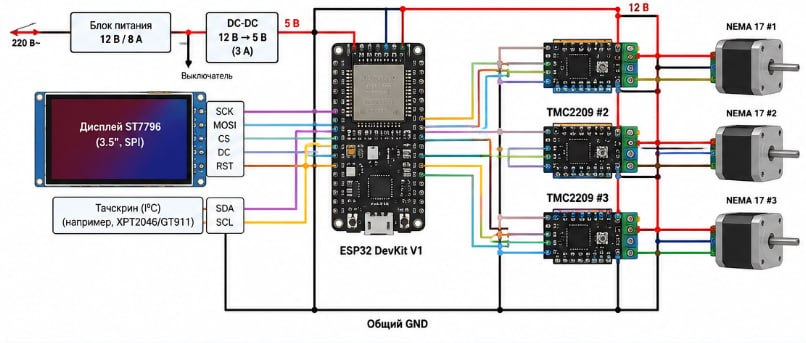

# FEEDER — отчёт 5

«Кормушка для студентов» выдаёт вкусняшки за правильные ответы. В отчёте описано как менялась схема от первой версии до актуальной.

## Версии схемы

| Версия | Схема | Привод | Питание |
| --- | --- | --- | --- |
| v1 | [черновик](docs/schematic_v1.png) | 3 × NEMA17 + 3 × TMC2209 | БП 12 В / 8 А → DC-DC 5 В |
| v2 | [Cirkit Designer](https://app.cirkitdesigner.com/project/8f1e15a8-e7d7-452f-acdd-f87753753af8) | 3 × NEMA17 + 3 × TMC2209 | БП 12 В / 8 А → DC-DC 5 В |
| **v3 (актуальная)** | [Cirkit Designer](https://app.cirkitdesigner.com/project/2ff4cc32-c2ec-4b87-b214-350b13d04e35) | **1 серво 360°** | **адаптер 12 В / 3 А → 2 DC-DC (5 В и ~6 В)** |

- **v1** — первый набросок: ESP32, дисплей ST7796, тач, три шаговика через драйверы.
- **v2** — та же схема, перенесённая в Cirkit Designer + ИК датчик и динамики.
- **v3** — схема наиболее близкая к конечному варианту.

## Что сократили (v1 → v3)

- 3 шаговика и 3 драйвера TMC2209 → **1 серво**.
- Большой БП 12 В / 8 А → **адаптер 12 В / 3 А**.
- Подсчёт оборотов: **датчик Холла** (A3144 + магнит), ИК-датчик только для подтверждения падения.
- Тач: резистивный XPT2046 → **ёмкостный (I²C)**, как у экрана.
- Контроллер только ESP32, без одноплатного компьютера; питание только от сети, без аккумулятора.
- Три отдельные схемы → **одна актуальная**.

Добавлено: концевик двери KW12-3 и динамик 8 Ом с усилителем PAM8403.

## Распиновка v3 (ESP32 DevKit V1)

| Узел | Сигналы | GPIO |
| --- | --- | --- |
| Дисплей ST7796 (SPI) | SCK, MOSI, MISO | 18, 23, 19 |
| Дисплей | CS, DC, RST | 27, 26, 17 |
| Тач (I²C) | SDA, SCL, INT, RST | 21, 22, 34, 33 |
| Серво | сигнал | 32 |
| Датчик Холла | OUT | 35 |
| ИК-датчик | OUT | 4 |
| Концевик двери | вход | 16 |
| Звук (PAM8403) | вход с ЦАП | 25 |

## Питание v3

220 В → адаптер 12 В / 3 А → DC-DC 5 В (ESP32, PAM8403, датчик Холла) и DC-DC ~6 В (только серво). Общая земля.
