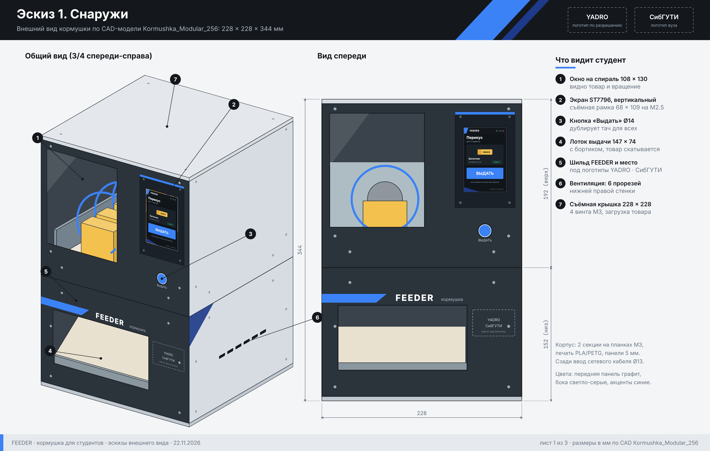
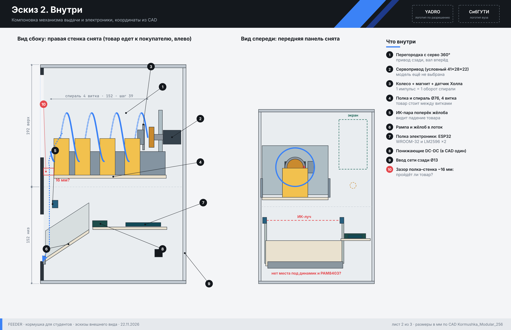
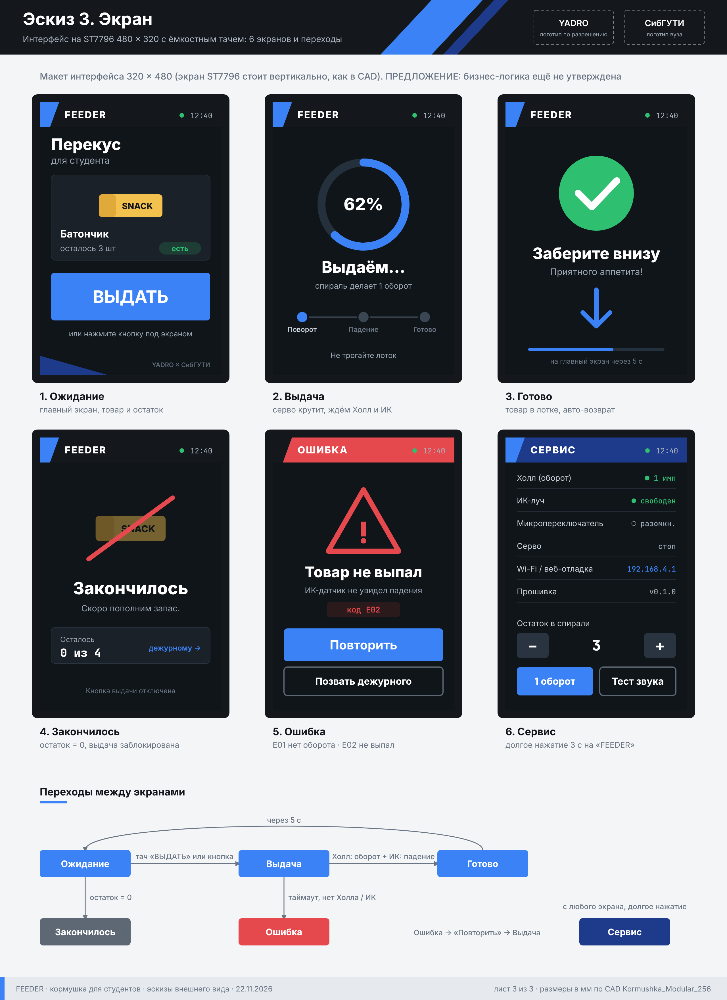

# Отчёт за неделю: эскизы внешнего вида

**Проект:** FEEDER, кормушка для студентов
**Дата:** 22.11.2026
**Тема недели:** эскизы внешнего вида: снаружи, внутри, экран

## Кратко

- Нарисовали три эскиза: корпус снаружи, компоновку внутри и интерфейс экрана (6 экранов и переходы между ними).
- Размеры эскизов снаружи и внутри взяты из CAD-модели `Kormushka_Modular_256`, ничего не придумано на глаз. Корпус 228 × 228 × 344 мм, две секции на планках M3.
- Стиль сочетает YADRO и СибГУТИ: графит, белый, два синих акцента и диагональные плашки в духе конструктивизма. Вместо логотипов оставлены пустые места. Почему так, см. раздел «Стиль».
- Нашли 9 открытых вопросов. Самые важные: размер экрана (3.5" или 4.0") и зазор 16 мм на пути товара.

## На чём основаны эскизы

| Источник | Что взяли |
|---|---|
| CAD `Kormushka_Modular_256` (STEP, `build_modular.py`, чертежи ЕСКД A3) | Габариты, положение окон, экрана, кнопки, спирали, серво, датчиков, рампы, полки электроники |
| Схема в Cirkit Designer (`FEEDER.png`) | Состав электроники: ESP32 WROOM-32, ST7796 с тачем, 2 × LM2596, FC-51, датчик Холла, микропереключатель, PAM8403 и динамик |
| Решения команды от 22.11 | Пружинная спираль, питание только от сети |

<details>
<summary>Скриншоты CAD, по которым сверялись</summary>


</details>

## 1. Снаружи



- **Верхняя секция (192 мм):** окно 108 × 130 мм на спираль, чтобы было видно товар и вращение. Справа экран ST7796 в съёмной рамке, под ним кнопка «Выдать» Ø14 мм.
- **Нижняя секция (152 мм):** лоток выдачи 147 × 74 мм с бортиком, над ним шильд FEEDER. Справа от лотка оставлено место под логотипы.
- **Корпус:** спереди графитовая панель, бока светло-серые. На правой нижней стенке 6 вентиляционных прорезей, крышка съёмная (4 винта M3). Сетевой кабель заходит сзади (Ø13 мм).

## 2. Внутри



Как выдаётся товар:

1. Студент нажимает «Выдать» на экране или кнопку.
2. Серво 360° за перегородкой проворачивает спираль (Ø76 мм, 4 витка, шаг 39 мм) на один оборот.
3. Колесо с магнитом проходит мимо датчика Холла. Один импульс значит один оборот, после этого серво останавливается.
4. Товар падает с края полки через ИК-луч (датчик подтверждает выдачу) и скатывается по рампе в лоток.

Внизу стоит полка электроники с ESP32 и DC-DC. В спираль помещается около 4 единиц товара.

## 3. Экран



> **Это предложение.** Бизнес-логика ещё не утверждена: кому и сколько выдаём, нужна ли оплата или лимит. Экраны нарисованы под самый простой сценарий: бесплатно, по нажатию.

В CAD экран стоит вертикально, поэтому макеты сделаны в портретной ориентации 320 × 480.

| № | Экран | Когда показывается |
|---|---|---|
| 1 | Ожидание | Главный экран: товар, остаток, большая кнопка «ВЫДАТЬ» |
| 2 | Выдача | Серво крутит спираль. Шаги: поворот, падение, готово |
| 3 | Готово | Сработал ИК-датчик. «Заберите внизу», через 5 с возврат на главный |
| 4 | Закончилось | Остаток = 0, кнопка выдачи отключена |
| 5 | Ошибка | `E01`: нет импульса Холла (спираль не провернулась). `E02`: ИК не увидел падения |
| 6 | Сервис | Долгое нажатие 3 с на «FEEDER». Состояние датчиков, IP веб-отладки, ручной остаток, тест оборота и звука |

Остаток считает прошивка: при загрузке товара его выставляют вручную на экране «Сервис». Датчика наличия в схеме нет.

## Стиль YADRO × СибГУТИ

- **YADRO.** На сайте компании сказано, что её вдохновляют конструктивизм (Татлин, Веснины) и принцип «функция определяет форму» ([yadro.com/philosophy](https://www.yadro.com/en/philosophy)). Поэтому в эскизах простые геометрические плашки, диагонали и ничего лишнего.
- **Логотипы.** На странице [yadro.com/trademark](https://www.yadro.com/en/trademark) сказано, что знаки YADRO, включая графический логотип, нельзя использовать без письменного разрешения правообладателя (policy@yadro.com). Поэтому логотипы не рисовали, а оставили пунктирные места. Логотип СибГУТИ тоже нужно взять у вуза в официальном виде.
- **Цвета.** Официальные брендбуки найти не удалось, поэтому палитра пока условная и собрана в одном месте в начале `src/generate_sketches.py`:

| Токен | Цвет | Откуда |
|---|---|---|
| `INK` | `#14181d` графит | основной тёмный |
| `BLUE` | `#3b82f6` | theme-color сайта YADRO, **фирменным не подтверждён** |
| `NAVY` | `#1e3a8a` | условный синий за СибГУТИ, **заменить по брендбуку** |
| `OK` / `WARN` | `#2fbf71` / `#e5484d` | статусы на экране |

Шрифты: Inter и JetBrains Mono, оба свободные. После получения брендбуков цвета меняются в одном месте, и эскизы перегенерируются командой `python3 src/generate_sketches.py img`.

## Файлы

```
img/01_snaruzhi.png|svg   эскиз снаружи
img/02_vnutri.png|svg     эскиз внутри
img/03_ekran.png|svg      макет экрана
```
